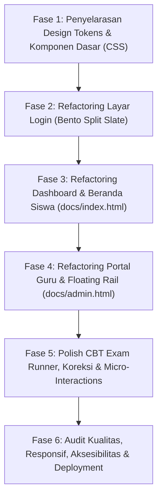

# Rencana Refactoring UI/UX SITURI LMS
## Berdasarkan Konsep Desain `design/UI UX.md`, `login-2-bento-slate.html`, `dashboard-2-bento-slate.html`, dan Stitch Design System

---

## 1. Latar Belakang & Visi Desain

Portal SITURI (Sistem Informasi Terpadu Pembelajaran Interaktif) SMPN 1 Umbulsari dirancang untuk berjalan di atas infrastruktur ringan (GitHub Pages + Firebase Spark Plan, biaya $0). Desain antarmuka dituntut untuk:
1. **Sangat cepat dan ringan (Zero Bloat)**: Bebas dari framework CSS besar (Bootstrap/Tailwind runtime), berbasis Vanilla CSS Tokens dan Native ES Modules.
2. **Ramah perangkat siswa**: Optimal pada smartphone entry-level (layar 360–420px, resolusi rendah, koneksi seluler tidak stabil).
3. **Ergonomis bagi guru**: Tata letak desktop efisien untuk monitor sekolah 1366×768 (viewport vertikal efektif ~550px), mencegah kelelahan administratif.

Dokumen ini memetakan seluruh konsep dari folder `design/` menjadi **rencana refactoring UI/UX bertahap yang terukur, aman, dan siap dieksekusi tanpa mengganggu fungsi Firebase yang sedang berjalan**.

---

## 2. Pilar & Prinsip Utama (The 7 Canonical Principles)

Berdasarkan `design/UI UX.md`:

| No | Prinsip | Implementasi Praktis di SITURI |
|---|---|---|
| **1** | **Satu Aksi Utama per Layar** | Setiap view hanya memiliki 1 tombol primary paling kontras (`--ink` / `--primary`); tombol lainnya berupa ghost, soft, atau text button. |
| **2** | **Hirarki Lewat Garis (Hairlines over Shadows)** | Menggunakan border `1px solid var(--line)` dan pemisah `var(--line-soft)`. Drop shadow hanya diizinkan untuk modal floating/dialog. |
| **3** | **Ruang Vertikal Itu Mahal** | Menghilangkan widget kartu raksasa di bagian atas; menggantinya dengan **1-Row Horizontal Stat Strip** (tinggi < 100px). |
| **4** | **Angka Rata (`tabular-nums`)** | Semua angka nilai, jam, menit countdown timer, kuota, dan tanggal wajib memakai `font-variant-numeric: tabular-nums` untuk mencegah layout jitter. |
| **5** | **Anti-Panik & Komunikasi Humanis** | Tidak ada `alert()` / `confirm()` bawaan browser. Menggunakan callout kontekstual, toast pill melayang (auto-dismiss 3s), dan SweetAlert2 khusus untuk aksi destruktif (hapus permanen, publish massal). |
| **6** | **Aksesibilitas Dasar & Anti Auto-Zoom** | Semua form input di mobile memiliki `font-size: 16px` (mencegah auto-zoom paksa di browser iOS/Android), touch target ≥ 44×44px, dan `:focus-visible` kontras. |
| **7** | **Satu Komponen, Dua Viewport** | Proteksi `overflow-x: clip` global pada `html` dan `body`, layout beradaptasi seamless antara desktop split grid dan mobile single stack tanpa horizontal scrolling. |

---

## 3. Sistem Token & Visual Tokens (Editorial Minimalist Academic)

Sesuai token kanonik di `design/UI UX.md` dan `design/stitch/design_systems.json`:

### 3.1 Token Warna & Peran Semantik
```css
:root {
  /* Surface & Canvas */
  --bg: #f4f5f7;
  --paper: #f8fafc;
  --surface: #ffffff;
  --surface-low: #f2f4f6;
  --surface-high: #e6e8ea;

  /* Hairlines & Borders */
  --line: #e2e8f0;
  --line-soft: #f1f5f9;

  /* Typography / Inks */
  --ink: #0f172a;
  --ink-2: #5b6169;
  --ink-3: #8d939b;

  /* Primary & Accents */
  --primary: #1d4ed8;
  --primary-hover: #1e40af;
  --accent: #2563eb;
  --accent-soft: #eff6ff;

  /* Status Colors */
  --ok: #16a34a;
  --ok-soft: #f0fdf4;
  --warn: #d97706;
  --warn-soft: #fffbeb;
  --danger: #dc2626;
  --danger-soft: #fef2f2;

  /* 4-Tipe Taksonomi AKM */
  --badge-pg: #1d4ed8;
  --badge-pg-bg: #eff6ff;
  --badge-bs: #16a34a;
  --badge-bs-bg: #f0fdf4;
  --badge-match: #d97706;
  --badge-match-bg: #fffbeb;
  --badge-essay: #dc2626;
  --badge-essay-bg: #fef2f2;

  /* Geometri & Radius */
  --radius-card: 14px;
  --radius-panel: 18px;
  --radius-input: 9px;
  --radius-chip: 6px;
  --radius-pill: 999px;
}
```

---

## 4. Pemetaan Layar & Desain Baru per Modul

### 4.1 Halaman Login Terpadu (Konsep Bento Split Slate)
*Referensi visual: `design/login-2-bento-slate.html`*

- **Desktop (Split 1.05fr : 0.95fr)**:
  - **Panel Kiri (Form Interaktif)**:
    - Top bar: Brand SITURI dengan status pill "Semester Ganjil 2026/2027".
    - Heading: "Masuk ke SITURI", sub: "Portal Pembelajaran Digital SMPN 1 Umbulsari".
    - Role Switcher Pill: Tab ringkas `Siswa` vs `Guru / Admin`.
    - Input Email & Password dengan visual clean, focus ring biru, tombol "Tampilkan Sandi".
    - 1 Primary Button penuh: "Masuk ke Portal".
    - Demo Account Chips: Chip 1-klik untuk akun uji coba (misal: "Akun Siswa Demo", "Akun Guru Demo").
  - **Panel Kanan (Bento Slate Showcase)**:
    - Bento 1: *Pengumuman Asesmen* (Jadwal CBT & tanggal pelaksanaan).
    - Bento 2: *Status Server & Jaringan* (Badge "Online / Spark Optimized").
    - Bento 3: *Panduan Akses Cepat* (Informasi bantuan akun dan tata tertib asesmen).
- **Mobile (≤ 768px)**:
  - Otomatis reflow menjadi kartu form vertikal bersih dengan banner ringkasan sekolah di bagian atas.

---

### 4.2 Portal Siswa (`docs/index.html`)
*Referensi visual: Stitch Screens `Beranda Siswa`, `Materi Pembelajaran`, `Tugas & Pengumpulan`, `Asesmen CBT (MATCH)`*

1. **Header Sapaan & Profil Siswa**:
   - Teks sapaan kontekstual ("Selamat pagi/siang, [Nama Siswa]") + Badge Kelas `(c1)` + Avatar inisial.
2. **Hero CTA Card (The Rule of One Primary Action)**:
   - Satu kartu sorotan utama yang dinamis:
     - *Jika ada ujian CBT aktif*: Menampilkan kartu ujian berbatas aksen biru, badge "Ujian Resmi", countdown waktu mulai/berakhir, dan tombol besar "Mulai Ujian Sekarang".
     - *Jika tidak ada ujian*: Menampilkan tugas dengan batas tenggat waktu terdekat.
3. **1-Row Stat Strip Siswa (3 Kolom)**:
   - Kolom 1: Materi Dibaca · Kolom 2: Tugas Terkumpul · Kolom 3: Rata-rata Nilai.
   - Dipisahkan hairline vertikal, angka semi-bold tabular.
4. **Pembaruan Modul Pembelajaran (Bento Feed)**:
   - Kartu materi dengan thumbnail 44px, estimasi waktu baca, chip mata pelajaran, dan indikator centang "Telah Dibaca".
5. **Modul Pengumpulan Tugas**:
   - Kartu tugas dengan format tanggal Indonesia ("23 Nov 2026, 15.00"), badge status ("Belum Mengumpulkan" vs "Tersimpan"), dan modal pengumpulan tugas responsif.
6. **CBT Exam Runner & Tap-to-Pair MATCH**:
   - Pemolesan kartu tap-to-pair (Kolom A & Kolom B) dengan state tactile: border seleksi aktif, chip pasangan terhubung, tombol silang hapus pasangan, dan timer pill melayang `mm:ss` di sudut atas.
7. **Mobile Bottom Navigation (Sticky 56px)**:
   - 4 Tab ikonik: Beranda, Materi, Tugas, Nilai.
   - Ikon 20px, label 10.5px, hit area 44px touch-friendly.

---

### 4.3 Portal Guru (`docs/admin.html`)
*Referensi visual: `design/dashboard-2-bento-slate.html`, Stitch Screens `Ringkasan Dashboard Guru`, `Asesmen Builder`, `Koreksi`*

1. **Floating Bento Sidebar (`aside.rail`)**:
   - Lebar 230–240px, rounded `18px`, sticky `top: 16px`, background `--surface`.
   - Brand SITURI + SMPN 1 Umbulsari + status pill.
   - Menu bernavigasi teks + ikon jelas:
     - Ringkasan
     - Materi Pembelajaran
     - Penugasan Siswa
     - Asesmen & Bank Soal
     - Koreksi & Penilaian
   - Profil footer guru dengan avatar inisial dan tombol keluar cepat.
2. **Dashboard Ringkasan (Asymmetric Split 1.45fr : 1fr)**:
   - **Header & 1-Row Stat Strip (4 Kolom)**:
     - Materi Aktif, Menunggu Dinilai, Ulangan Terjadwal, Rata-rata Ujian.
   - **Kolom Kiri (1.45fr - Alur Kerja Utama)**:
     - Daftar tugas menunggu pemeriksaan guru.
     - Ringkasan asesmen aktif dengan status pengerjaan siswa.
   - **Kolom Kanan (1fr - Konteks & Jadwal)**:
     - Widget "Jadwal & Agenda Hari Ini".
     - Widget "Aktivitas Terbaru Siswa" (feed waktu nyata dengan status dot).
     - Widget "Progres Penilaian Guru" (progress bar proporsional).
3. **Form Panel Transisi (Drawer / Overlay Minimalis)**:
   - Form Tambah Materi (`#mat-form-panel`) dan Form Tugas (`#tug-form-panel`) tidak lagi merusak aliran halaman ke bawah, melainkan ditampilkan sebagai drawer overlay rapi dengan multi-chip kelas target.
4. **Asesmen & Bank Soal Builder**:
   - Header builder dengan stat strip 3 kolom: Jumlah Butir, Akumulasi Bobot, Estimasi Durasi.
   - Toolbar aksi: Tombol "Pratinjau Asesmen" (toggle 375px HP vs Desktop), "+ Modal Butir Soal", dan "Simpan & Terbitkan".
   - Kartu soal modular dengan badge warna 4-tipe soal (`PG`, `BS`, `MATCH`, `ESSAY`).
5. **Koreksi & Analisis Butir Soal**:
   - Integrasi tabel Analisis Butir Soal ($P$-value tingkat kesulitan) lengkap dengan peringatan remedial merah untuk butir < 30%.
   - Tombol navigasi lembar siswa `‹ Sebelumnya` dan `Berikutnya ›`.
   - Tombol ekspor terpadu (Rekap CSV Tugas + Ujian).

---

## 5. Rencana Tahapan Eksekusi (Roadmap Fase 1 – 5)

Setiap fase dirancang independen, dapat di-commit terpisah, dan mematuhi batasan aturan ukuran file (`check-file-size.ps1`: JS ≤ 400 baris, CSS ≤ 300 baris).



### Rincian Fase Eksekusi:

#### Fase 1: Penyelarasan Design Tokens & Komponen Dasar
- Perbarui `docs/css/base/tokens.css` dengan token warna Bento Slate dan padding scale kanonik.
- Perbarui `docs/css/components/card.css` untuk mendukung Bento cards, hairlines `1px solid var(--line)`, dan border radius `14px`.
- Perbarui `docs/css/components/button.css` untuk tombol primary bertema `--ink`/`--primary` dan ghost button.
- Verifikasi batas baris file CSS (seluruh file tetap ≤ 300 baris).

#### Fase 2: Refactoring Layar Login (Bento Split Slate)
- Perbarui markup `#sec-login` di `docs/index.html` dan `#sec-auth` di `docs/admin.html` mengadopsi grid 2-kolom `1.05fr : 0.95fr` (sesuai `design/login-2-bento-slate.html`).
- Tambahkan panel informasi samping (pengumuman asesmen sekolah, status server, bantuan akun).
- Sediakan chip pengisian cepat (demo credentials) untuk mempermudah pengujian.
- Buat styling responsif mobile (1 kolom tumpuk rapi).

#### Fase 3: Refactoring Portal Siswa (`docs/index.html`)
- Terapkan layout header sapaan personal + badge kelas.
- Implementasikan Hero CTA Card dinamis (Ujian Aktif vs Tugas Terdekat).
- Ganti container statistik lama dengan 1-Row Stat Strip (3 kolom tabular).
- Polishing kartu materi pembelajaran dan kartu pengumpulan tugas.
- Sempurnakan bottom navigation bar 4 tab di layar mobile.

#### Fase 4: Refactoring Portal Guru (`docs/admin.html`)
- Implementasikan Floating Bento Sidebar (`aside.rail`) sticky dengan rounded `18px`.
- Rombak `#sec-ringkasan` dengan layout asimetris `1.45fr : 1fr` (Alur kerja utama di kiri, Jadwal & Aktivitas di kanan).
- Ubah form panjang materi & tugas menjadi panel drawer/modal bersih.
- Rapikan tampilan Bank Soal Builder dan tabel data agar hemat ruang vertikal.

#### Fase 5: Polish CBT Exam Runner, Koreksi & Micro-Interactions
- Poles UI kartu tap-to-pair pada soal MATCH siswa dengan micro-animation dan status visual pasang.
- Terapkan countdown timer pill sticky pada sesi ujian siswa.
- Sambungkan dialog pratinjau soal (viewport HP 375px vs Desktop) pada admin builder.
- Rapikan tabel analisis butir soal dan ekspor CSV di halaman koreksi.

#### Fase 6: Audit Kualitas, Line Count & Rilis
- Jalankan verifikasi script `engineering/scripts/check-file-size.ps1`.
- Uji responsivitas pada viewport 360px, 412px, 768px, 1024px, dan 1366px.
- Pengujian fungsional Firebase (Auth, Firestore Read/Write, Batch publish, Versioned cache).
- Commit, push ke GitHub, dan deploy ke Firebase Hosting.

---

## 6. Standar Koding & Pengawasan Mutu

1. **Aturan Baris File (Strict)**:
   - File JS (`docs/js/**/*.js`): Maksimal **400 baris**.
   - File CSS (`docs/css/**/*.css`): Maksimal **300 baris**.
   - Validasi via: `powershell -ExecutionPolicy Bypass -File engineering/scripts/check-file-size.ps1`.
2. **Kepatuhan Schema Firestore**:
   - Refactoring UI/UX ini murni peningkatan visual & interaksi; **tidak mengubah struktur koleksi** `quizzes`, `quizKeys`, `attempts`, `results`, `materials`, `assignments`, `submissions`, maupun aturan keamanan Firestore (`firestore.rules`).
3. **Zero Bundler**:
   - Seluruh modul ditulis dalam Vanilla ES Module murni dan CSS murni tanpa Node build runner untuk menjaga kemudahan pemeliharaan selamanya di GitHub Pages / Firebase Hosting.
