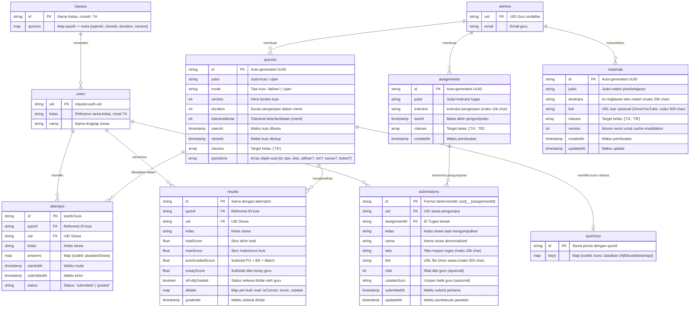

# Dokumen Perancangan Teknis & Produk (v0.8): Ekstensi LMS Sekolah Hemat Kuota Spark

Dokumen ini merupakan addendum arsitektur dan spesifikasi produk untuk implementasi fitur **Materi**, **Tugas & Pengumpulan**, serta **Perluasan Engine Asesmen 4 Tipe Soal** pada LMS sekolah berbasis frontend statis (GitHub Pages) dan Firebase Spark Plan ($0, client-side only via Firebase JS SDK v11 modular, tanpa Cloud Functions & Cloud Storage).

---

## A. PRD Addendum (v0.8)

### 1. Fitur Materi (Learning Materials)

#### a. Tujuan
Memfasilitasi distribusi materi pembelajaran dari guru ke siswa dalam bentuk teks terstruktur dan tautan eksternal (Google Drive / YouTube) tanpa menggunakan storage binary, dengan konsumsi kuota Firestore mendekati 0 untuk akses berulang.

#### b. Aktor
- **Guru (Admin)**: Membuat, menyunting, dan menghapus dokumen materi per kelas/mata pelajaran.
- **Siswa (Anonymous Auth)**: Membaca materi sesuai kelas yang terdaftar pada profilnya.

#### c. User Stories
- Sebagai Guru, saya dapat membagikan catatan pelajaran dan menyematkan link materi (slide Google Drive / video YouTube) agar siswa dapat belajar mandiri tanpa sekolah membayar biaya hosting berkas.
- Sebagai Siswa, saya dapat membaca rangkuman materi dan membuka referensi link tanpa mengonsumsi kuota read berlebihan meski halaman di-refresh berkali-kali.

#### d. Data Schema (`materials/{materialId}`)
| Field | Tipe | Keterangan |
| :--- | :--- | :--- |
| `id` | `string` | Auto-generated ID Firestore |
| `judul` | `string` | Judul materi (maks 150 karakter) |
| `deskripsi` | `string` | Konten teks materi / ringkasan (markdown/teks biasa, maks 20.000 karakter) |
| `link` | `string` (opsional) | URL valid eksternal (Drive, YouTube, dsb., maks 500 karakter) |
| `classes` | `array of string` | Daftar target kelas, contoh: `["7A", "7B"]` |
| `createdAt` | `timestamp` | Waktu pembuatan (`serverTimestamp()`) |
| `updatedAt` | `timestamp` | Waktu pembaruan terakhir (`serverTimestamp()`) |
| `version` | `number` | Integer penanda revisi untuk cache invalidation |

#### e. Ringkasan Firestore Rules
- Koleksi: `materials/{id}`
- **Read**: `request.auth != null` (Semua user yang login, baik siswa anonim maupun guru, dapat membaca).
- **Write (Create/Update/Delete)**: `request.auth != null && exists(/databases/$(database)/documents/admins/$(request.auth.uid))` (Hanya guru terdaftar).

#### f. Analisis Dampak Kuota & Pola Hemat Kuota
- **Pola Hemat Kuota**:
  - *Client-side Cache (SessionStorage/LocalStorage)*: Materi bersifat *semi-immutable*. Simpan payload materi di `localStorage` per `materialId` berserta `version`.
  - Siswa membaca daftar metadata materi yang ditargetkan untuk kelasnya satu kali saat sesi dibuka. Dokumen isi detail materi hanya di-fetch saat siswa mengklik item jika belum ada di storage lokal.
- **Reads/Writes per Aksi**:
  - Guru membuat/edit materi: 1 Write.
  - Siswa membuka daftar & membaca 3 materi: 1 Read (query list berdasarkan kelas) + 3 Read (fetch pertama kali) = 4 Reads. Kunjungan berikutnya pada hari yang sama = 0 Reads (Cache Hit).
- **Worst-Case Harian (1.000 Siswa Aktif, 5 Materi Baru/Hari)**:
  - 1.000 siswa × 1 read (list) + (1.000 siswa × 5 materi baru) = 6.000 Reads/hari (hanya 12% dari limit harian 50.000 Spark).

#### g. Alur UI/UX
- **Guru (`admin.html`)**: Menu "Kelola Materi" $\rightarrow$ Form input [Judul, Target Kelas (checkbox/multi-select), Isi Ringkasan (textarea), Link Tambahan (input URL)] $\rightarrow$ Simpan $\rightarrow$ Muncul pada tabel daftar materi dengan opsi Edit/Hapus.
- **Siswa (`index.html`)**: Tab "Materi" $\rightarrow$ Daftar card materi yang relevan dengan `users/{uid}.kelas` $\rightarrow$ Klik card $\rightarrow$ Membuka modal/tampilan baca teks + tombol "Buka Tautan Materi" (jika ada URL). Embed YouTube responsif jika link terdeteksi format video YouTube.

#### h. Edge Case & Mitigasi
- *Siswa membuka materi di perangkat berbeda*: Cache disimpan per perangkat; fetch ulang wajar terjadi sekali per perangkat.
- *Link eksternal rusak/privat*: Validasi URL dengan regex sederhana di klien; beri catatan panduan bagi guru bahwa file Google Drive harus disetel ke "Anyone with the link can view".

---

### 2. Fitur Tugas + Pengumpulan (Assignments & Submissions)

#### a. Tujuan
Memungkinkan guru memberikan instruksi penugasan dengan tenggat waktu (*due date*), serta memfasilitasi siswa menyerahkan jawaban berbasis teks dan tautan (Drive tugas siswa) dengan pembatasan 1 pengumpulan per siswa per tugas, tanpa biaya penyimpanan berkas.

#### b. Aktor
- **Guru (Admin)**: Membuat/mengelola penugasan dan meninjau seluruh pengumpulan siswa per tugas.
- **Siswa (Anonymous Auth)**: Melihat tugas kelasnya dan mengumpulkan/memperbarui kiriman sebelum *due date*.

#### c. User Stories
- Sebagai Guru, saya dapat menugaskan proyek/PR dengan tenggat waktu tertentu dan memeriksa tautan/teks jawaban siswa secara terorganisir per kelas.
- Sebagai Siswa, saya dapat mengumpulkan link tugas saya dan memastikan pengumpulan saya berhasil tersimpan tanpa membuat duplikasi data.

#### d. Data Schema
##### `assignments/{assignmentId}`
| Field | Tipe | Keterangan |
| :--- | :--- | :--- |
| `id` | `string` | Auto-generated ID Firestore |
| `judul` | `string` | Judul tugas (maks 150 karakter) |
| `instruksi` | `string` | Detail instruksi tugas (maks 10.000 karakter) |
| `dueAt` | `timestamp` | Batas akhir pengumpulan |
| `classes` | `array of string` | Daftar kelas yang ditugaskan |
| `createdAt` | `timestamp` | Waktu dibuat |

##### `submissions/{subId}`
*Catatan Arsitektur*: Format Document ID **wajib deterministik**: `{uid}__{assignmentId}`.
| Field | Tipe | Keterangan |
| :--- | :--- | :--- |
| `uid` | `string` | ID Siswa (`request.auth.uid`) |
| `assignmentId` | `string` | ID Tugas referensi |
| `kelas` | `string` | Kelas siswa saat mengumpulkan (denormalisasi untuk query guru) |
| `nama` | `string` | Nama siswa (denormalisasi untuk kemudahan UI guru) |
| `teks` | `string` | Jawaban teks siswa (maks 20.000 karakter) |
| `link` | `string` (opsional) | URL lampiran luar (Google Docs/Drive/GitHub, maks 500 karakter) |
| `submittedAt` | `timestamp` | Waktu submit pertama kali |
| `updatedAt` | `timestamp` | Waktu pembaruan terakhir |
| `nilai` | `number` (opsional) | Nilai dari guru (0 - 100) |
| `catatanGuru` | `string` (opsional) | Umpan balik dari guru |

#### e. Ringkasan Firestore Rules
- `assignments/{id}`:
  - **Read**: `request.auth != null`
  - **Write**: Guru only (`admins/{uid}`).
- `submissions/{subId}`:
  - **ID Dokumen**: Wajib format `$(request.auth.uid)__$(request.resource.data.assignmentId)`.
  - **Read**: Pemilik submission (`request.auth.uid == resource.data.uid`) ATAU Guru (`admins/{uid}`).
  - **Create/Update**: Pemilik submission saja, memvalidasi ukuran `teks <= 20000`, `link <= 500`, dan integritas field `uid == request.auth.uid`.
  - **Update Nilai**: Guru only dapat memperbarui field `nilai` dan `catatanGuru`.

#### f. Analisis Dampak Kuota & Pola Hemat Kuota
- **Pola Hemat Kuota**:
  - *Deterministik Document ID*: Menggunakan format `{uid}__{assignmentId}` meniadakan perlunya siswa menjalankan query `where('uid', '==', ...)` untuk mengecek status kirimannya. Siswa cukup melakukan *point read* (`doc(db, 'submissions', subId)`), hemat resource indeks & read.
  - *Lazy-loading Pengumpulan untuk Guru*: Guru hanya me-load submission per kelas/per tugas saat filter dipilih (tidak melakukan auto-listen snapshot secara global).
- **Reads/Writes per Aksi**:
  - Siswa melihat detail tugas & status kirimannya: 1 Read (`assignments`) + 1 Read (`submissions/{subId}`) = 2 Reads.
  - Siswa submit tugas: 1 Write.
  - Guru melihat rekap 1 kelas (35 siswa): 35 Reads.
- **Worst-Case Harian (10 Tugas aktif, 1.000 Siswa mengumpulkan)**:
  - Siswa: 1.000 × 2 Reads (buka tugas) = 2.000 Reads; 1.000 Writes (submit).
  - Guru memeriksa 5 kelas (total 175 submissions): 175 Reads.
  - Total Reads $\approx$ 2.175 (4.3% dari limit 50.000), Writes $\approx$ 1.000 (5% dari limit 20.000).

#### g. Alur UI/UX
- **Guru (`admin.html`)**: Tab "Tugas" $\rightarrow$ Buat Tugas Baru (input Judul, Instruksi, Batas Waktu, Target Kelas). Di daftar tugas, klik "Lihat Pengumpulan" $\rightarrow$ Menampilkan tabel siswa, status (Sudah/Belum), link berkas yang bisa diklik, textarea nilai & feedback cepat.
- **Siswa (`index.html`)**: Tab "Tugas" $\rightarrow$ List tugas dengan badge status "Belum Dikumpulkan" / "Sudah Dikumpulkan" / "Terlewat". Klik tugas $\rightarrow$ Muncul instruksi + form pengumpulan (textarea jawaban dan input URL Google Drive/Doc). Jika sudah pernah submit, form terisi otomatis dan tombol berubah menjadi "Perbarui Jawaban".

#### h. Edge Case & Mitigasi
- *Pengumpulan lewat batas waktu (late submission)*: Validasi di client-side memblokir tombol submit jika `currentTime > dueAt`. Security rules juga dapat memvalidasi perbandingan timestamp jika dibutuhkan.
- *Izin akses link Drive siswa masih terkunci (private)*: UI siswa memberikan peringatan banner kuning tebal: *"Pastikan link Google Drive disetel ke 'Siapa saja yang memiliki link dapat melihat' sebelum dikumpulkan!"*.

---

### 3. Asesmen 4 Tipe Soal (Perluasan Engine Kuis)

#### a. Tujuan
Memperluas kapabilitas asesmen sekolah untuk mendukung format AKM/Asesmen Nasional:
1. Pilihan Ganda (PG) — *Auto-grading*
2. Benar/Salah (BS) — *Auto-grading*
3. Menjodohkan / Mencocokkan (Match) — *Auto-grading*
4. Uraian Singkat / Essay — *Manual Grading oleh Guru*
Sistem tetap aman dari kebocoran kunci jawaban pada mode 'ujian' dan mendukung pengacakan soal deterministik per siswa via PRNG seed UID di klien.

#### b. Aktor
- **Guru (Admin)**: Meracik soal dalam 4 variasi tipe, menerbitkan ujian/latihan, dan memberikan nilai manual untuk butir essay.
- **Siswa (Anonymous Auth)**: Mengerjakan soal dengan tampilan antarmuka adaptif sesuai tipe soal.

#### c. User Stories
- Sebagai Guru, saya dapat menyusun variasi soal yang kaya (PG, Benar-Salah, Menjodohkan, dan Essay) pada satu kuis terpadu.
- Sebagai Guru, pada mode 'ujian', kunci jawaban tidak boleh sampai terkirim ke browser siswa dalam bentuk network payload apa pun.
- Sebagai Siswa, saya mendapatkan tampilan interaktif yang nyaman untuk memasangkan item menjodohkan dan menuliskan jawaban essay.

#### d. Data Schema
##### Struktur Objek Soal dalam Dokumen `quizzes/{quizId}`
Dokumen `quizzes` berisi array `questions: []`. Pada mode **'ujian'**, field `kunci` pada semua tipe soal **dihilangkan (stripped)** dari dokumen `quizzes` dan disimpan terpisah di `quizKeys/{quizId}`.

```typescript
// 1. Pilihan Ganda (PG)
interface SoalPG {
  id: string;
  tipe: 'pg';
  teks: string;
  pilihan: { key: 'A'|'B'|'C'|'D'; teks: string }[];
  bobot?: number; // default: 1
  kunci?: 'A'|'B'|'C'|'D'; // Hanya ada di quizKeys (mode ujian) atau quizzes (mode latihan)
}

// 2. Benar / Salah (BS)
interface SoalBS {
  id: string;
  tipe: 'bs';
  teks: string; // Pernyataan yang diuji
  bobot?: number; // default: 1
  kunci?: 'true'|'false'; // Hanya ada di quizKeys atau latihan
}

// 3. Menjodohkan (Match)
interface SoalMatch {
  id: string;
  tipe: 'match';
  teks: string; // Instruksi perjodohan
  kiri: string[]; // Premis / Pertanyaan, misal: ["Ibukota RI", "Mata Uang RI"]
  kanan: string[]; // Opsi / Pasangan teracak, misal: ["Rupiah", "Nusantara", "Ringgit"]
  bobot?: number; // default: 1
  kunci?: Record<string, string>; // misal: {"Ibukota RI": "Nusantara", "Mata Uang RI": "Rupiah"}
}

// 4. Essay Singkat
interface SoalEssay {
  id: string;
  tipe: 'essay';
  teks: string; // Pertanyaan essay
  bobot?: number; // default: 1
  // Tidak ada kunci otomatis; dinilai oleh guru
}
```

##### Struktur Dokumen Jawaban Siswa `attempts/{startId}`
```typescript
interface AttemptDocument {
  id: string; // startId
  quizId: string;
  uid: string;
  kelas: string;
  startedAt: Timestamp;
  submittedAt: Timestamp;
  answers: {
    [soalId: string]: 
      | string // untuk PG ('A') & BS ('true'|'false')
      | string // untuk Essay (isi teks jawaban siswa)
      | Record<string, string>; // untuk Match: { "Ibukota RI": "Nusantara" }
  };
  status: 'submitted' | 'graded';
}
```

##### Struktur Dokumen Hasil `results/{attemptId}`
```typescript
interface ResultDocument {
  id: string; // attemptId
  quizId: string;
  uid: string;
  kelas: string;
  totalScore: number;
  maxScore: number;
  autoGradedScore: number; // Subtotal PG + BS + Match
  essayScore: number; // Subtotal Essay dari guru
  isFullyGraded: boolean; // false jika ada essay yang belum diperiksa guru
  details: {
    [soalId: string]: {
      tipe: 'pg' | 'bs' | 'match' | 'essay';
      isCorrect?: boolean; // untuk auto-graded
      score: number;
      studentAnswer: any;
      correctAnswer?: any; // Disalin dari quizKeys saat guru/sistem menilai
      catatan?: string; // Catatan guru khusus untuk koreksi essay
    };
  };
  gradedAt: Timestamp;
}
```

#### e. Ringkasan Firestore Rules
- `quizzes/{id}`: Read = Semua user auth; Write = Guru only.
- `quizKeys/{id}`: Read = Guru only (`admins/{uid}`); Write = Guru only. **Siswa sama sekali tidak punya akses read ke koleksi ini.**
- `attempts/{id}`:
  - Create = Pemilik attempt (`request.auth.uid == request.resource.data.uid`).
  - Read = Pemilik attempt ATAU Guru.
- `results/{id}`:
  - Create = Mode latihan (siswa create nilainya sendiri), Mode ujian (guru yang menulis result setelah grading).
  - Update = Guru only (untuk memperbarui skor essay).
  - Read = Pemilik result ATAU Guru.

#### f. Analisis Dampak Kuota & Pola Hemat Kuota
- **Pola Hemat Kuota**:
  - *PRNG Shuffle di Klien*: Urutan soal diacak di browser menggunakan algoritma Fisher-Yates dengan seed deterministik `hash(quizId + uid)`. Tidak ada penulisan urutan soal ke database.
  - *Grading Batch Client-Side oleh Guru (Mode Ujian)*:
    1. Guru membuka menu penilaian kuis tertentu di `admin.html`.
    2. Guru me-read `quizKeys/{quizId}` **tepat 1 kali**.
    3. Guru melakukan query batch `attempts` untuk kuis tersebut.
    4. Klien guru menghitung skor otomatis (PG, BS, Match) untuk seluruh siswa sekaligus di memori browser guru.
    5. Guru hanya perlu membaca/mengoreksi essay yang tampil di layar, memasukkan angka, lalu menekan tombol "Simpan & Publikasikan Nilai Batch" (menggunakan Firestore `writeBatch`).
- **Reads/Writes per Aksi**:
  - Siswa mengerjakan ujian: 1 Read (`classes/{kelas}` untuk meta) + 1 Read (`quizzes/{quizId}`) + 1 Write (`attempts/{startId}`) = 2 Reads, 1 Write.
  - Siswa melihat hasil latihan: 1 Write (`results/{attemptId}`).
  - Guru menilai 1 kelas (35 siswa):
    - 1 Read (`quizKeys`) + 35 Reads (`attempts`) = 36 Reads.
    - 1 Commit Batch Write (35 `results`) = 35 Writes.
- **Worst-Case Harian (500 Siswa Ujian Serentak)**:
  - Siswa: 500 × 2 Reads = 1.000 Reads; 500 Writes.
  - Guru (15 sesi kelas): 15 × 1 Read (`quizKeys`) + 500 Reads (`attempts`) = 515 Reads; 500 Writes (`results`).
  - Total: ~1.515 Reads & ~1.000 Writes (Jauh di bawah limit harian 50k Reads / 20k Writes).

#### g. Alur UI/UX
- **Guru (`admin.html`)**:
  - Pembuat Kuis: Dropdown tipe soal $\rightarrow$ Form input spesifik:
    - *PG*: Input soal, 4 input opsi, radio button penentu kunci.
    - *BS*: Input pernyataan, radio button kunci Benar atau Salah.
    - *Match*: Form pasangan baris (Item Kiri $\leftrightarrow$ Pasangan Kanan).
    - *Essay*: Input pertanyaan essay + panduan/rubrik singkat untuk guru.
  - Penilaian Ujian: Menu "Koreksi Ujian" $\rightarrow$ Pilih Kuis & Kelas $\rightarrow$ Tabel rekapitulasi: Skor PG/BS/Match otomatis terisi $\rightarrow$ Klik "Periksa Essay" $\rightarrow$ Modal menampilkan butir essay siswa dan kolom input nilai (0 - maks) $\rightarrow$ Klik "Simpan & Rilis Nilai".
- **Siswa (`index.html`)**:
  - Antarmuka Asesmen: Timer melayang (*floating countdown*), navigasi nomor soal.
  - Render butir soal:
    - *PG*: Tombol radio A, B, C, D yang lebar & ramah sentuhan.
    - *BS*: 2 tombol seleksi tegas: [ BENAR ] / [ SALAH ].
    - *Match*: Dua kolom berdampingan. Kolom kiri berisi item statis; kolom kanan berupa dropdown pilihan yang mengambil opsi dari daftar kanan teracak.
    - *Essay*: Area teks (`textarea`) dengan counter karakter.
  - Autosave lokal: Setiap jawaban tersimpan otomatis di `sessionStorage` untuk proteksi jika koneksi terputus tiba-tiba.

#### h. Edge Case & Mitigasi
- *Kecurangan inspeksi inspect element/Network tab*: Pada mode 'ujian', payload dokumen `quizzes` bersih dari kunci jawaban. Soal essay tidak memiliki kunci sistem. Kunci jawaban aman di `quizKeys` yang dilindungi Security Rules.
- *Browser tertutup/koneksi mati saat ujian*: Jawaban terakhir dibaca dari `sessionStorage`. Saat browser dibuka kembali, waktu sisa dihitung berdasarkan `attempt.startedAt + duration`, mencegah kecurangan me-refresh halaman untuk menambah waktu.

---

## B. ERD (Entity Relationship Diagram)



---

## C. Workflow

```mermaid
flowchart TD
    %% SUBGRAPH 1: GURU MEMBUAT KONTEN
    subgraph WF1 ["1. Guru Membuat Materi, Tugas, & Asesmen"]
        G1(["Guru Login di admin.html"]) --> G2{Pilih Menu}
        
        %% Materi
        G2 -->|Materi| GM1["Isi Form: Judul, Teks, Link Drive/YT, Target Kelas"]
        GM1 --> GM2["Simpan ke collection 'materials'"]
        
        %% Tugas
        G2 -->|Tugas| GT1["Isi Form: Judul, Instruksi, Target Kelas, dueAt"]
        GT1 --> GT2["Simpan ke collection 'assignments'"]
        
        %% Asesmen
        G2 -->|Asesmen 4 Tipe| GA1["Input Metadata Kuis & Tambah Butir Soal"]
        GA1 --> GA2["Definisikan Tipe: PG, BS, Match, Essay"]
        GA2 --> GA3{Mode Kuis?}
        GA3 -->|Latihan| GA4["Kunci disimpan inline di questions (array)"]
        GA4 --> GA6["Commit ke 'quizzes/(id)'"]
        GA3 -->|Ujian| GA5["Strip kunci dari questions (array)"]
        GA5 --> GA7["Simpan soal tanpa kunci ke 'quizzes/(id)'"]
        GA5 --> GA8["Simpan kunci rahasia ke 'quizKeys/(id)'"]
    end

    %% SUBGRAPH 2: SISWA BACA MATERI & TUGAS
    subgraph WF2 ["2. Siswa Membaca Materi & Mengumpulkan Tugas"]
        S1(["Siswa Buka index.html - Anon Auth"]) --> S2["Cek Cache Lokal"]
        S2 -->|Cache Miss| S3["Read Sekali: 'materials' & 'assignments' sesuai kelas"]
        S2 -->|Cache Hit| S4["Gunakan Data dari LocalStorage"]
        
        S3 --> S5{Aksi Siswa}
        S4 --> S5
        
        %% Baca Materi
        S5 -->|Buka Materi| SM1["Tampilkan Teks Materi + Link Embed Eksternal"]
        
        %% Kumpul Tugas
        S5 -->|Buka Tugas| ST1["Cek Dokumen Deterministik: 'submissions/(uid)__(assignmentId)'"]
        ST1 --> ST2{Sudah Submit?}
        ST2 -->|Belum| ST3["Tampilkan Form Kosong: Teks & Link Drive Tugas"]
        ST2 -->|Sudah| ST4["Tampilkan Jawaban Tersimpan + Opsi Edit"]
        ST3 --> ST5["Submit Jawaban sebelum dueAt"]
        ST4 --> ST5
        ST5 --> ST6["Write ke 'submissions/(uid)__(assignmentId)'"]
    end

    %% SUBGRAPH 3: SISWA MENGERJAKAN ASESMEN
    subgraph WF3 ["3. Siswa Mengerjakan Asesmen 4 Tipe"]
        A1(["Siswa Buka Menu Kuis"]) --> A2["Fetch 'quizzes/(quizId)' - Tanpa Kunci jika Ujian"]
        A2 --> A3["Hitung PRNG Seed: hash-uid-quizId"]
        A3 --> A4["Acak Urutan Soal & Opsi Match di Klien"]
        A4 --> A5["Tampilkan UI Soal Berdasarkan Tipe"]
        
        A5 --> A5_PG["PG: Radio Pilihan A-D"]
        A5 --> A5_BS["BS: Tombol Benar / Salah"]
        A5 --> A5_M["Match: Dropdown Pasangan Kiri-Kanan"]
        A5 --> A5_E["Essay: Textarea Input Jawaban"]
        
        A5_PG & A5_BS & A5_M & A5_E --> A6["Autosave berkala ke SessionStorage"]
        A6 --> A7["Klik Selesai / Waktu Habis"]
        A7 --> A8["Write Jawaban Siswa ke 'attempts/(startId)'"]
        
        A8 --> A9{Mode Kuis?}
        A9 -->|Latihan| A10["Auto-grading Langsung di Klien Siswa"]
        A10 --> A11["Write ke 'results/(attemptId)' & Tampilkan Nilai"]
        A9 -->|Ujian| A12["Tampilkan Notifikasi: Berhasil Dikirim, Menunggu Penilaian"]
    end

    %% SUBGRAPH 4: GURU MENILAI
    subgraph WF4 ["4. Guru Menilai (Auto PG/BS/Match + Manual Essay)"]
        GR1(["Guru Buka Koreksi Ujian di admin.html"]) --> GR2["Pilih Kuis & Kelas Target"]
        GR2 --> GR3["Read 'quizKeys/(quizId)' - 1x Saja"]
        GR3 --> GR4["Read Query: 'attempts' pada kuis & kelas tersebut"]
        
        GR4 --> GR5["Engine Klien Guru: Auto-Grade PG, BS, & Match"]
        GR5 --> GR6{Ada Soal Essay?}
        
        GR6 -->|Tidak Ada| GR7["Hitung Skor Total 100% Otomatis"]
        GR6 -->|Ada Soal Essay| GR8["Tampilkan Antarmuka Koreksi Essay Guru"]
        GR8 --> GR9["Guru Input Nilai Manual & Umpan Balik per Butir Essay Siswa"]
        
        GR9 --> GR10["Hitung Total: autoGradedScore + essayScore"]
        GR7 --> GR10
        GR10 --> GR11["Klik 'Publikasikan Nilai'"]
        GR11 --> GR12["Batch Write ke 'results/(attemptId)' untuk Semua Siswa"]
        GR12 --> GR13["Update status 'attempts' menjadi 'graded'"]
    end
```



---

## D. Checklist Implementasi

### 1. `firestore.rules`
- [ ] **Koleksi `materials/{id}`**:
  - [ ] Pastikan rule `allow read: if request.auth != null;` aktif.
  - [ ] Tambahkan validasi write guru: `allow write: if request.auth != null && exists(/databases/$(database)/documents/admins/$(request.auth.uid));`.
  - [ ] Tambahkan validasi payload write: `request.resource.data.judul.size() <= 150` dan `request.resource.data.deskripsi.size() <= 20000`.
- [ ] **Koleksi `assignments/{id}`**:
  - [ ] Read untuk semua user auth; write hanya admin/guru.
  - [ ] Validasi panjang instruksi (`size() <= 10000`).
- [ ] **Koleksi `submissions/{subId}`**:
  - [ ] Validasi document ID deterministik: `subId == request.auth.uid + '__' + request.resource.data.assignmentId`.
  - [ ] Atur read: `request.auth.uid == resource.data.uid || exists(/databases/$(database)/documents/admins/$(request.auth.uid))`.
  - [ ] Batasi ukuran kiriman siswa: `request.resource.data.teks.size() <= 20000` dan `request.resource.data.link.size() <= 500`.
  - [ ] Cegah siswa mengubah field `nilai` dan `catatanGuru`.
- [ ] **Koleksi `quizzes/{id}` & `quizKeys/{id}`**:
  - [ ] Pastikan `quizKeys/{id}` memiliki proteksi ketat: `allow read, write: if exists(/databases/$(database)/documents/admins/$(request.auth.uid));`.
- [ ] **Koleksi `results/{id}`**:
  - [ ] Siswa hanya dapat membuat result jika kuis bersangkutan berstatus mode `latihan`.
  - [ ] Update nilai result hanya diizinkan untuk admin/guru.

---

### 2. `admin.html` (Panel Guru)
- [ ] **Modul Manajemen Materi**:
  - [ ] Buat tab UI baru "Materi Pembelajaran".
  - [ ] Form input materi: Judul, Target Kelas (checkboxes), Konten Ringkasan (textarea), Link Tambahan (input URL).
  - [ ] Fungsi simpan: memanggil `addDoc(collection(db, 'materials'), {...})` dengan `version: 1` dan `serverTimestamp()`.
  - [ ] Tabel daftar materi dengan aksi Hapus (`deleteDoc`) dan Edit.
- [ ] **Modul Manajemen Tugas**:
  - [ ] Buat tab UI baru "Penugasan".
  - [ ] Form buat tugas: Judul, Target Kelas, Batas Waktu (`datetime-local`), dan Instruksi Tugas.
  - [ ] Tampilan monitoring penugasan: dropdown filter tugas $\rightarrow$ memanggil query `collection(db, 'submissions')` yang difilter berdasarkan `assignmentId`.
  - [ ] Kolom koreksi cepat tugas: input nilai angka + umpan balik guru langsung pada baris tabel submission.
- [ ] **Ekstensi Pembuat Asesmen (4 Tipe Soal)**:
  - [ ] Update form builder kuis dengan selector tipe: `Pilihan Ganda`, `Benar/Salah`, `Menjodohkan`, `Essay`.
  - [ ] Tampilan input kondisional:
    - *PG*: Render 4 field pilihan + radio button kunci.
    - *BS*: Render pernyataan + opsi radio Benar / Salah.
    - *Match*: Form pasangan baris dinamis (tambah baris: teks kiri & teks kanan).
    - *Essay*: Area input teks pertanyaan tanpa field kunci.
  - [ ] Logika pemisahan kunci (Mode Ujian):
    - Fungsi *stripper* otomatis: kloning array `questions`, ekstrak semua field `kunci` ke objek `keysMap`.
    - Simpan array bersih ke `quizzes/{quizId}` dan `keysMap` ke `quizKeys/{quizId}` menggunakan `writeBatch()`.
- [ ] **Modul Grading Terpadu (Koreksi Ujian & Essay)**:
  - [ ] Antarmuka "Koreksi Hasil Ujian": Pilih Kuis & Kelas.
  - [ ] Ambil `quizKeys/{quizId}` (1 read).
  - [ ] Ambil seluruh `attempts` yang relevan.
  - [ ] Engine auto-grading di browser guru:
    - Match evaluation: bandingkan pasangan `studentAnswer[kiri] === key[kiri]`.
    - Hitung subtotal nilai otomatis.
  - [ ] Komponen koreksi essay: tampilkan daftar jawaban essay siswa dengan input skor per butir.
  - [ ] Tombol "Publikasikan Nilai": mengeksekusi `writeBatch` untuk membuat dokumen `results` secara kolektif tanpa memicu write berulang manual.

---

### 3. `index.html` (Portal Siswa)
- [ ] **Penyimpanan Lokal & Pola Hemat Kuota**:
  - [ ] Implementasikan helper modul `StorageCache`: simpan data materi dan tugas di `localStorage` terindeks ID dan timestamp.
- [ ] **Tampilan Menu Materi**:
  - [ ] Tab UI "Materi": Fetch data materi yang menargetkan `user.kelas` (hanya dokumen yang belum ada di cache atau versinya berubah).
  - [ ] Modal baca materi yang rapi, dilengkapi tombol buka link luar dan deteksi parser otomatis untuk URL YouTube (`<iframe>`).
- [ ] **Tampilan Menu Tugas**:
  - [ ] Tab UI "Tugas": Tampilkan daftar tugas aktif dan tenggat waktunya.
  - [ ] Gunakan pembacaan deterministik untuk status pengumpulan: `doc(db, 'submissions', auth.currentUser.uid + '__' + assignmentId)`.
  - [ ] Form submit tugas: textarea respon + input link Drive. Validasi client-side: peringatan jika izin link Drive belum publik dan pencegahan submit jika waktu telah melewati `dueAt`.
- [ ] **Engine Pengerjaan Kuis 4 Tipe Soal**:
  - [ ] Implementasi PRNG deterministik (Linear Congruential Generator / Mulberry32) dengan seed berbasis string `quizId + auth.currentUser.uid`.
  - [ ] Algoritma pengacak urutan soal dan pengacak item opsi kolom kanan untuk soal Menjodohkan (*Match*).
  - [ ] Komponen UI pengerjaan kuis:
    - Render kartu soal adaptif berdasarkan `soal.tipe`.
    - *Match UI*: Kolom kiri statis, kolom kanan dropdown select yang berisi daftar item kanan yang telah teracak.
    - *Essay UI*: Textarea dengan limitasi counter karakter.
  - [ ] Mekanisme autosave jawaban ke `sessionStorage` pada setiap event perubahan input (mencegah kehilangan data saat reload).
  - [ ] Submit akhir:
    - Format objek `answers` terstandarisasi.
    - Kirim payload ke `attempts/{startId}`.
    - Jika mode `latihan`: langsung hitung skor di klien dan buat dokumen `results/{attemptId}`. Jika mode `ujian`: tampilkan dialog selesai dan arahkan siswa kembali ke dashboard.
